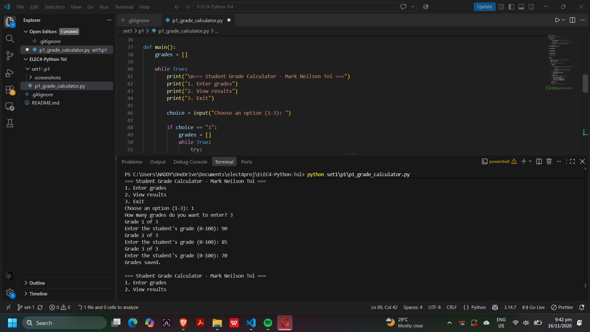
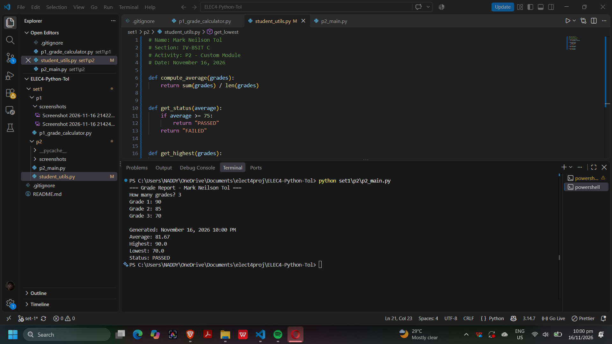
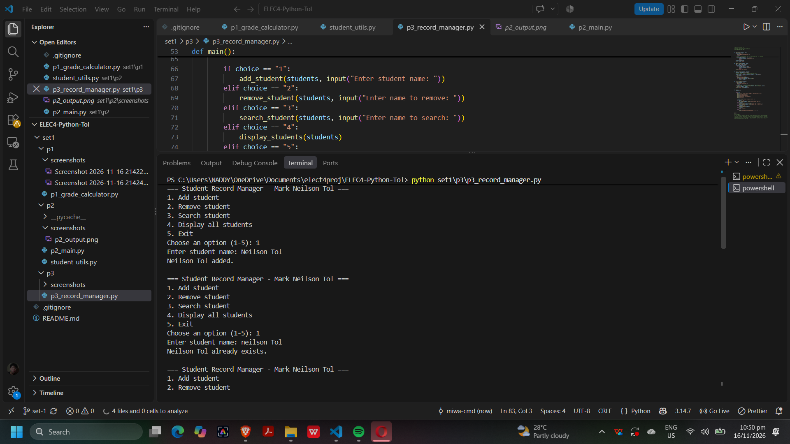
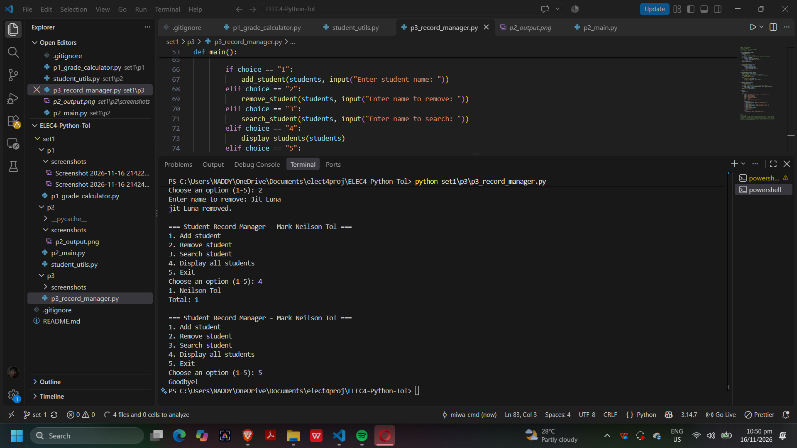
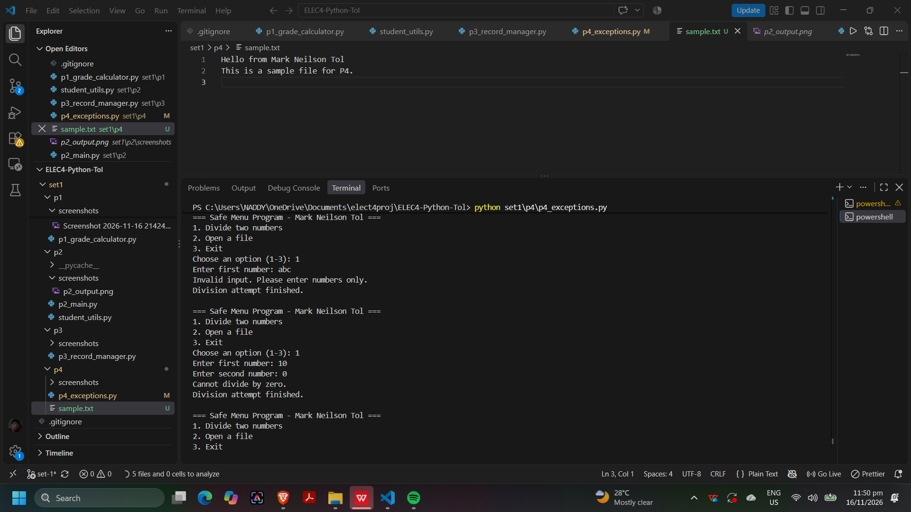
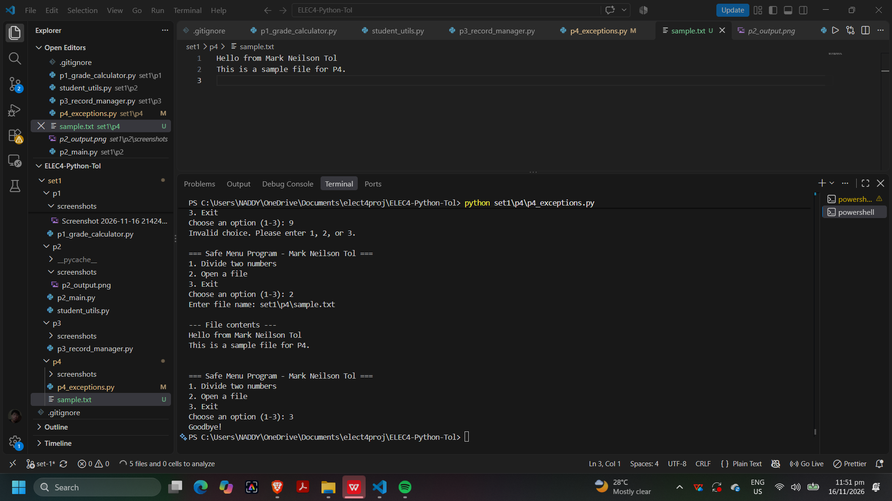

# ELEC 4 - Python Programming

**Name:** Mark Neilson Tol
**Section:** IV-BSIT C
**Course:** ELEC 4 - Python Programming

## Activities (Set 1)

| Activity | Description | Folder |
|---|---|---|
| P1 | Menu-driven grade calculator using functions | [set1/p1](set1/p1) |
| P2 | Custom module `student_utils` with a main program | [set1/p2](set1/p2) |
| P3 | Student record manager (add, remove, search, display) | [set1/p3](set1/p3) |
| P4 | Safe menu program with exception handling | [set1/p4](set1/p4) |

## How to run

Run these from the root of the repository:

```
python set1/p1/p1_grade_calculator.py
python set1/p2/p2_main.py
python set1/p3/p3_record_manager.py
python set1/p4/p4_exceptions.py
```

## Screenshots

### P1



### P2


### P3





### P4


