# ELEC 4 - Python Programming

**Name:** Mark Neilson Tol
**Section:** IV-BSIT C
**Course:** ELEC 4 - Python Programming

## Activities (Set 1)

| Activity | Description | Folder |
|----------|-------------|--------|
| P1 | Menu-driven grade calculator using functions | [set1/p1](set1/p1) |
| P2 | Custom module `student_utils` with a main program | [set1/p2](set1/p2) |
| P3 | Student record manager (add, remove, search, display) | [set1/p3](set1/p3) |
| P4 | Safe menu program with exception handling | [set1/p4](set1/p4) |

## How to run (Set 1)

Run these from the root of the repository:

```
python set1/p1/p1_grade_calculator.py
python set1/p2/p2_main.py
python set1/p3/p3_record_manager.py
python set1/p4/p4_exceptions.py
```

## Screenshots (Set 1)

### P1

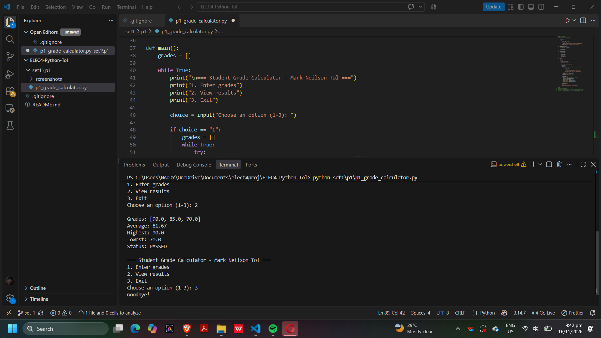

### P2


### P3

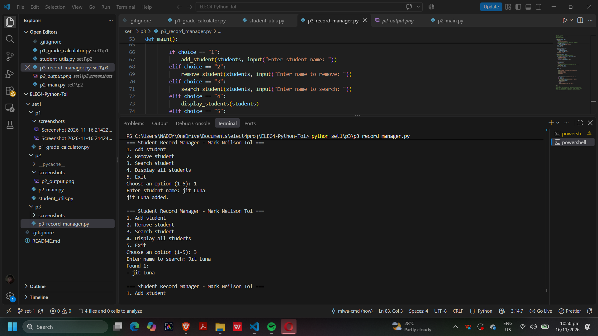
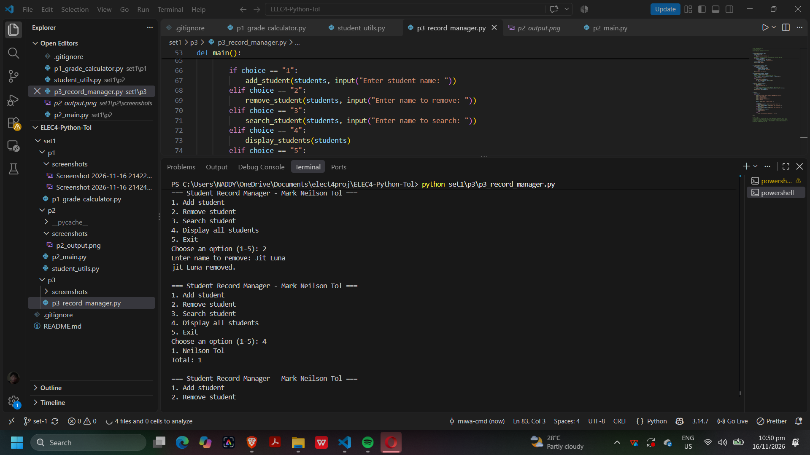


### P4

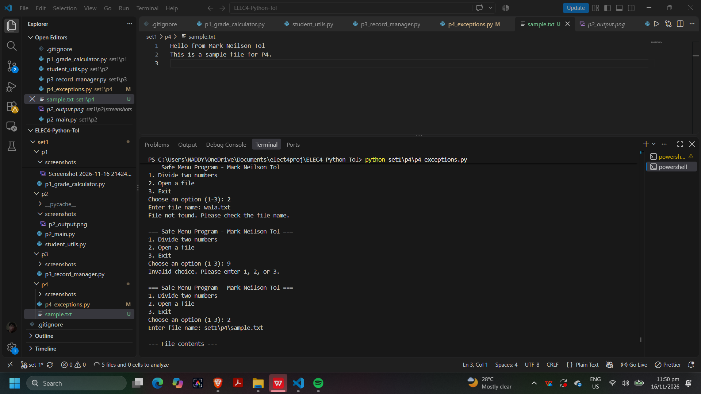


## Activities (Set 2)

| Activity | Description | Folder |
|----------|-------------|--------|
| P5 | Student information file system using `students.txt` | [set2/p5](set2/p5) |
| P6 | Recursion toolkit (factorial, fibonacci, sum, search) | [set2/p6](set2/p6) |
| P7 | School system with classes and a private grade | [set2/p7](set2/p7) |
| P8 | Inheritance and polymorphism (Person, Student, Teacher) | [set2/p8](set2/p8) |

## How to run (Set 2)

Run these from the root of the repository:

```
python set2/p5/p5_file_system.py
python set2/p6/p6_recursion.py
python set2/p7/p7_classes.py
python set2/p8/p8_inheritance.py
```

## Screenshots (Set 2)

### P5
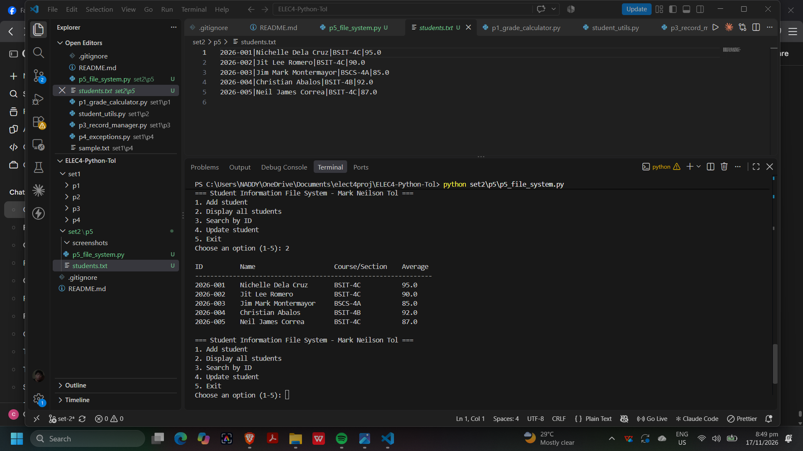
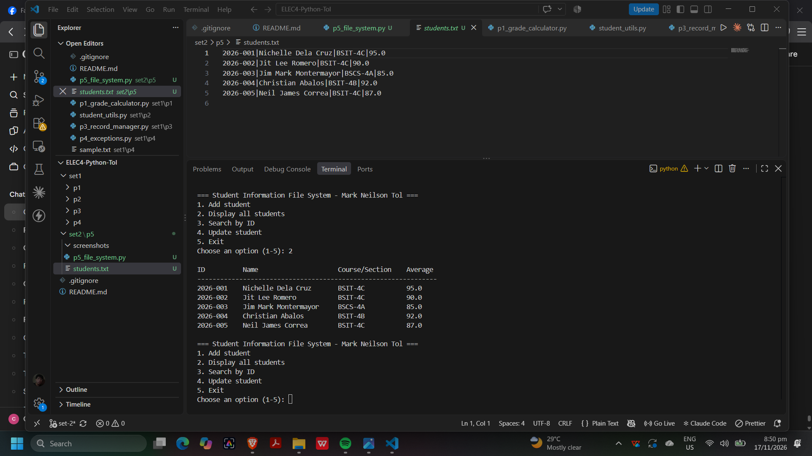
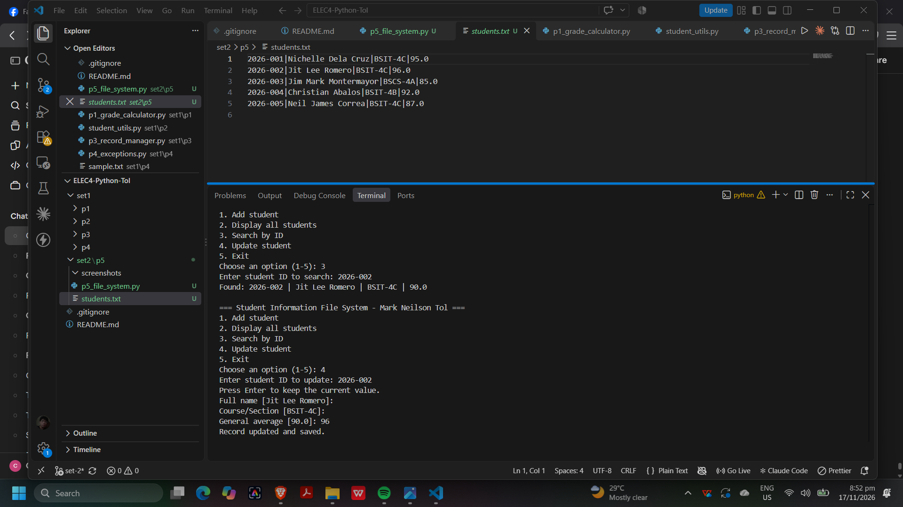
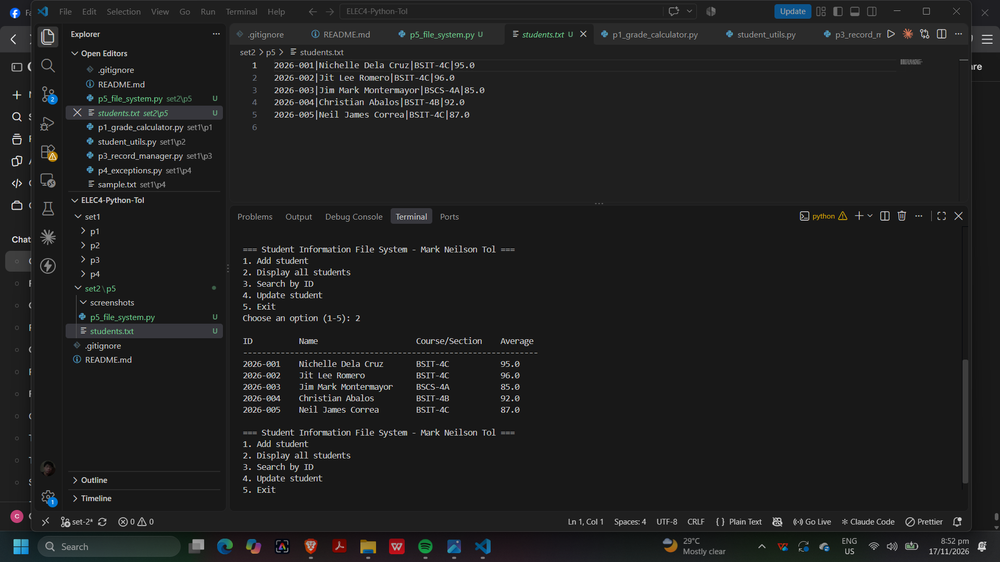
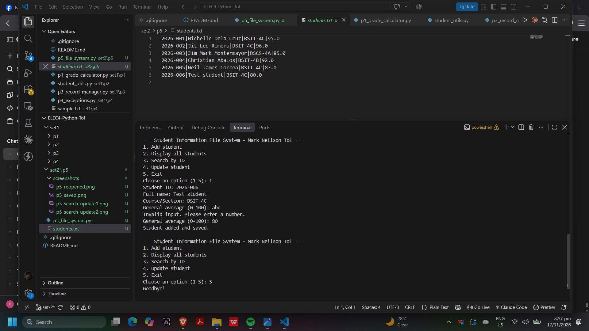

### P6
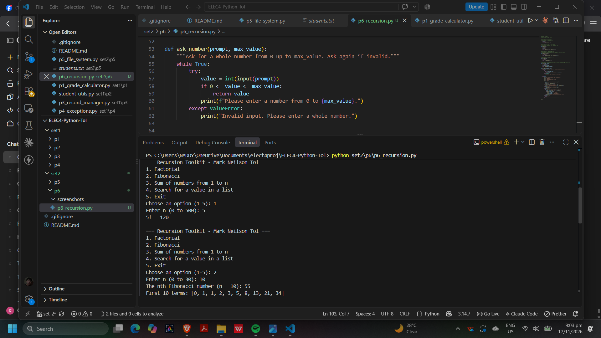
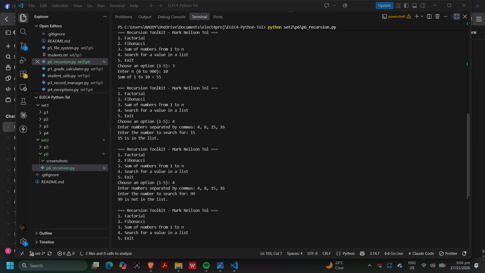

### P7
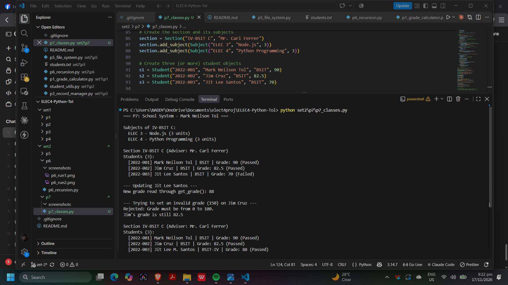

### P8
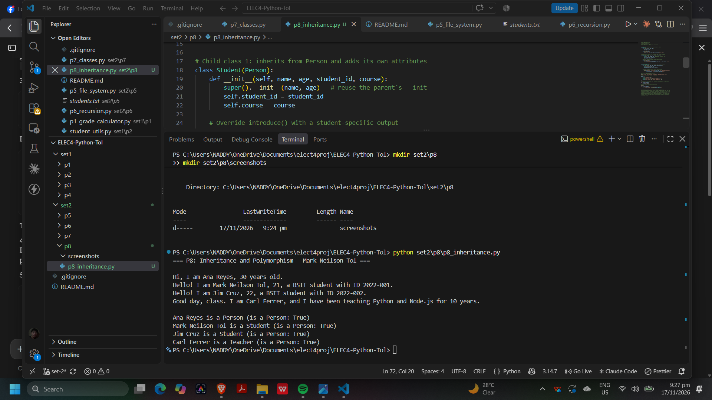